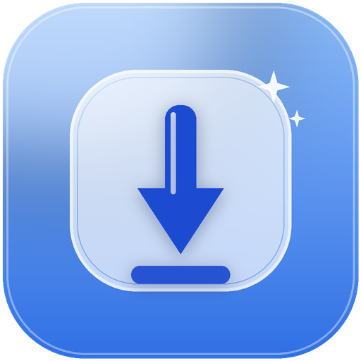

# 🎬 清影下载器 (QingYing Downloader)

<p align="center">
  
</p>

<p align="center">
  <b>全网多平台无水印视频与高清原图批量下载神器</b><br>
  内置 <code>yt-dlp</code> 与 <code>gallery-dl</code> 双下载内核 · 一键高速下载 抖音 / B站(4K) / 小红书 / TikTok / YouTube / Instagram<br>
  100% 纯本地运行 · 登录态本地安全隔离 · 永久免费开源 · 无广告弹窗
</p>

<p align="center">
  <a href="./README.en.md">English Documentation</a> | <b>简体中文</b>
</p>

<p align="center">
  
  
  
  
  
  
</p>

<p align="center">
  <a href="https://github.com/zhangtt08/multi-platform-video-downloader/releases/latest"><b>🚀 [点击立即下载 Windows 安装包 / 绿色免安装版]</b></a>
</p>

---

## ⚡ 为什么选择清影下载器？

无论自媒体创作者还是普通用户，在下载网络视频和图片素材时，往往深恶痛绝这些体验：
1. **第三方解析网站广告满天飞**：充斥诱导弹窗、诱导付费充值、解析画质被严重压缩，甚至暗藏木马风险；
2. **账号隐私与封号危险**：某些工具要求你手动提取并上传私人 Cookie，随时可能导致账号异地登录、被盗或被平台封禁；
3. **图集与视频无法兼得**：遇到小红书多图笔记、Instagram 轮播图或 B 站 4K 画质时，普通工具要么报错失败，要么只能下到模糊缩略图；
4. **命令行工具门槛过高**：`yt-dlp` 和 `gallery-dl` 虽然强大，但对普通用户来说命令行参数繁多难记，一旦网站风控规则改变就无从下手。

**清影下载器专为解决这些痛点而生！**  
它将业界最顶尖的开源下载内核打包进轻量极简、现代美观的 Windows 客户端中，让你只需粘贴一个链接，就能把超清视频或原图安全带回家！

---

## 🌐 支持的主流平台与内容

| 平台 | 支持能力说明 |
| :--- | :--- |
| 🎵 **抖音 (Douyin)** | 无水印单视频、实况动图、图集无水印大图批量打包下载 |
| 📺 **哔哩哔哩 (Bilibili)** | 支持最高 **4K / 1080P60** 高码率无损下载，音视频自动合并，支持分 P 批量解析 |
| 📕 **小红书 (Xiaohongshu)** | 无水印超清原图批量保存、视频无水印高清导出 |
| 📹 **YouTube** | 支持 4K/8K 视频下载、独立音轨提取 (MP3/M4A)、字幕提取 |
| 🌍 **TikTok** | 跨越海外地域与风控校验，一键高速下载无水印高清视频 |
| 📸 **Instagram** | 帖子单图/多图轮播、Reels 短视频全格式抓取 |
| 🌐 **上千家海量网站** | 原生继承 `yt-dlp` 支持的 1000+ 主流媒体网站 |

---

## ✨ 核心特性

- ⚡ **双内核智能自动降级**：视频优先调用 `yt-dlp` 高速下载；遇到图集或多图笔记自动无缝回退至 `gallery-dl`，图文全网打尽！
- 💎 **画质无损与音频自动合并**：支持自动将最高画质视频流与最佳音频流进行无损合并，支持 B 站 4K/1080P60 极清画质！
- 🔒 **五大平台安全会话持久化**：应用内集成隔离浏览器环境，支持一键登录 B 站、抖音、小红书、TikTok、Instagram（Cookie **全本地存储，绝不外泄**）！
- 🛡️ **独家反爬虫机制对抗**：深度优化请求头与浏览器指纹，轻松绕过 TikTok JS challenge、抖音 `modal_id` 鉴权与小红书反爬拦截！
- 📋 **极简下载队列**：实时查看下载进度、下载速率、剩余时间与状态，一键直接打开所在下载文件夹。
- 🤖 **AI Agent & MCP 支持**：内置本地 API 网关与 MCP 协议服务，支持让 Cursor、Claude Code 等智能体自动搜索并拉取创作素材！

---

## 📥 快速上手

### 方式一：下载安装包（推荐，开箱即用）
1. 前往 **[Releases 页面](https://github.com/zhangtt08/multi-platform-video-downloader/releases/latest)** 下载 `qingying-downloader-win-x64.exe`；
2. 双击运行打开 **清影下载器**；
3. 首次使用可在左侧「平台登录」中登录你的账号（获取更高清晰度，登录凭据仅存在本机）；
4. 在顶部输入框粘贴想要下载的分享链接，点击 **「解析并下载」** 即可！

### 方式二：开发者源码运行
```bash
git clone https://github.com/zhangtt08/multi-platform-video-downloader.git
cd multi-platform-video-downloader
npm install
npx electron .
```

---

## 🤖 自动化与 Agent API (MCP 协议)

清影下载器原生支持本地自动化调用，非常适合自媒体工作流、AI 批量创作管线：

```bash
# 启动面向 Agent 的 API 服务（默认端口 8790）
npm run agent:serve
```

支持 `qingying.analyze`（分析链接格式与标题）、`qingying.download`（提交下载任务）、`qingying.status`（查询任务进度）等指令。

---

## ⭐ 支持与致谢

如果清影下载器帮您解决了视频下载和素材采集的烦恼，请为本项目点亮一颗 **Star ⭐**！你的支持是它持续维护对抗反爬策略的最大动力！

## 📄 开源许可证
本项目基于 [MIT License](LICENSE) 协议开源。
